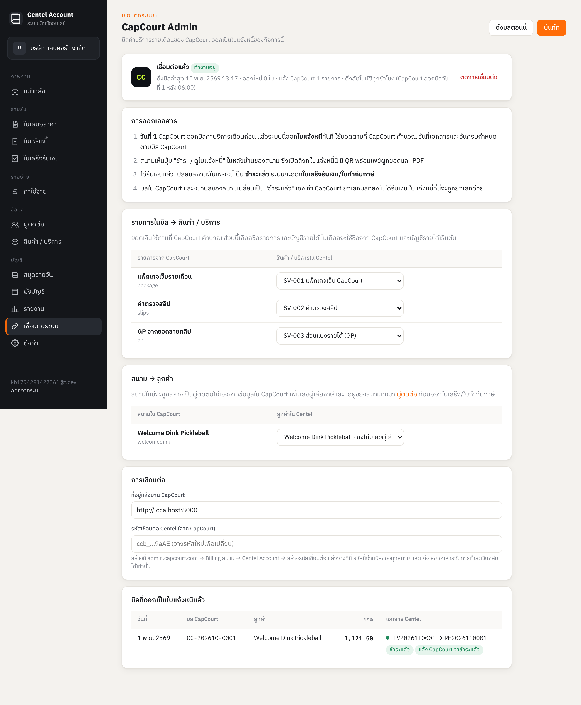

# Centel Account — ระบบบัญชีที่ account.centel.app

เว็บแอปบัญชีสำหรับ SME ไทย อยู่ในโฟลเดอร์ `account/` (หน้าเว็บ) และ `server/src/acc/` (API ที่ `/api/acc`)
ใช้บริการ `web` (Caddy) และ `api` + Postgres เดิมบน Railway ไม่มี service ใหม่

## ทำอะไรได้

- **กิจการ**: หลายกิจการต่อหนึ่งบัญชี ชื่อ เลขผู้เสียภาษี สาขา ที่อยู่ โลโก้ จด VAT หรือไม่ ตัวนำหน้าเลขที่เอกสาร หมายเหตุ ช่องทางชำระเงิน
- **ผู้ติดต่อ** (ลูกค้า / ผู้ขาย, นิติบุคคล / บุคคลธรรมดา) และ **สินค้า / บริการ** พร้อมบัญชีรายได้
- **เอกสารขาย**: ใบเสนอราคา (QT) → ใบแจ้งหนี้/ใบวางบิล (IV, เลือกเป็นใบกำกับภาษีได้) → ใบเสร็จรับเงิน (RE) หรือขายสดออกใบเสร็จเลย
  เลขที่รันอัตโนมัติ `IV2026110001`, VAT 7% รวม/ไม่รวม/ไม่มี, ส่วนลดรายบรรทัดและท้ายบิล, หัก ณ ที่จ่ายรายบรรทัด,
  พิมพ์ A4 ต้นฉบับ + สำเนา (บันทึกเป็น PDF จากหน้าพิมพ์), จำนวนเงินเป็นตัวอักษรภาษาไทย, ลิงก์ให้ลูกค้าเปิดดูโดยไม่ต้องล็อกอิน (`doc.html?t=`)
- **ค่าใช้จ่าย (EX)**: สแกนรูป/PDF บิลด้วย Claude (`RECEIPT_MODEL`) กรอกผู้ขาย รายการ ภาษีให้, ภาษีซื้อ, หัก ณ ที่จ่าย,
  บันทึกจ่ายเงินแล้วออกเลขที่ **หนังสือรับรอง 50 ทวิ** ให้ พิมพ์ได้ บนแบบฟอร์มของกรมสรรพากร (account/forms/50tawi.pdf) ระบบเติมเฉพาะช่อง (account/wht50.js)
- **บัญชีคู่อัตโนมัติ**: ผังบัญชีเริ่มต้น (`DEFAULT_ACCOUNTS` ใน `server/src/acc/ledger.js`), ทุกเอกสารลงสมุดรายวันเองทุกครั้งที่บันทึก/แก้/ยกเลิก,
  บันทึกรายการบัญชีทั่วไป (JV) เองได้, เพิ่มบัญชีธนาคารได้หลายบัญชี
- **รายงาน**: ภ.พ.30 สรุป, ภาษีขาย, ภาษีซื้อ, ภ.ง.ด.3, ภ.ง.ด.53, ภาษีถูกหัก ณ ที่จ่าย, งบกำไรขาดทุน, งบแสดงฐานะการเงิน, งบทดลอง,
  บัญชีแยกประเภท, ลูกหนี้/เจ้าหนี้ค้างแยกอายุหนี้, **สรุปยอดขาย** (ตามเอกสาร / ลูกค้า / สินค้า) ดาวน์โหลด Excel (.xlsx ผ่าน SheetJS จาก cdnjs) และพิมพ์ได้ทุกรายงาน
- **รับชำระเงิน**: ตั้งค่าบัญชีธนาคาร (สูงสุด 4) และพร้อมเพย์ ใบเสนอราคา/ใบแจ้งหนี้ที่ยังไม่ชำระพิมพ์ **QR พร้อมเพย์ผูกยอดชำระสุทธิ** (EMVCo + CRC16 ใน `account/thai.js`)
- **PDF**: ดาวน์โหลด A4 ได้ทั้งในแอปและลิงก์ลูกค้า (html2pdf.js จาก cdnjs, `doc.html?t=…&pdf=1` โหลดทันที)
  หน้าดูเอกสารเลือก ต้นฉบับ / สำเนา + จำนวนสำเนา, เปิดปิดข้อมูลการรับชำระ, ลายเซ็นและตราประทับ, ภาษาไทย / English
- **ลายเซ็นและตราประทับ**: อัปโหลดรูปในตั้งค่า ระบบลบพื้นหลังขาวให้เป็น PNG โปร่งใส (`acc_businesses.signature` / `stamp`)
  ใส่ในช่อง "ในนาม" ของกิจการ, ถ้าเลือก `signAuto` จะออกในลิงก์ลูกค้าด้วย (ไม่เลือก ลิงก์ลูกค้าจะไม่ได้รับรูปเลย)
- **รายการเอกสาร**: เปลี่ยนสถานะในแถว (ใบแจ้งหนี้ → ชำระแล้ว พาไปออกใบเสร็จ, ค่าใช้จ่าย → จ่ายแล้ว เปิดหน้าจ่ายเงิน), เมนู ⋯,
  เลือกหลายรายการแล้วดาวน์โหลด Excel / PDF รวม, แบ่งหน้า, ค่าใช้จ่ายมีรูปบิลและหมวดหมู่
- **สินค้า**: บริการ / สินค้าไม่นับสต็อก / สินค้านับสต็อก, รูป, บาร์โค้ด, ราคาทุน, ยอดยกมา, คงคลัง = ยกมา + ซื้อ (EX) − ขาย (IV + ขายสด) จาก `GET /stock`

## การลงบัญชี

| เอกสาร | เดบิต | เครดิต |
|---|---|---|
| ใบแจ้งหนี้ | ลูกหนี้การค้า | รายได้ตามบรรทัด, ภาษีขาย (ถ้าเป็นใบกำกับภาษี) หรือภาษีขายยังไม่ถึงกำหนด |
| ใบเสร็จจากใบแจ้งหนี้ | เงินสด/ธนาคาร (สุทธิ), ค่าธรรมเนียม, ภาษีถูกหัก ณ ที่จ่าย | ลูกหนี้การค้า (+ ย้ายภาษีขายยังไม่ถึงกำหนด → ภาษีขาย) |
| ใบเสร็จขายสด | เงินสด/ธนาคาร, ภาษีถูกหัก ณ ที่จ่าย | รายได้, ภาษีขาย |
| ค่าใช้จ่าย | ค่าใช้จ่ายตามบรรทัด, ภาษีซื้อ | เจ้าหนี้การค้า |
| จ่ายค่าใช้จ่าย | เจ้าหนี้การค้า, ค่าธรรมเนียม | เงินสด/ธนาคาร, ภาษีหัก ณ ที่จ่ายค้างนำส่ง |

ยอดเงินคำนวณที่เซิร์ฟเวอร์เป็นสตางค์ (`computeTotals`) ไม่เชื่อยอดจากเบราว์เซอร์ ส่วน `account/thai.js` มีสูตรเดียวกันไว้แสดงผลระหว่างกรอก
เอกสารที่ออกแล้วลบไม่ได้ ยกเลิกได้ (เลขที่ไม่ถูกใช้ซ้ำ, รายการบัญชีถูกลบ)

## ความปลอดภัย

ทุกตาราง `acc_*` มี `business_id` และ Row Level Security ผ่าน `acc_can()` (สมาชิกใน `acc_members`) API ทำงานเป็น `app_user` ทุกคำขอ
ลิงก์สาธารณะของเอกสารใช้ token สุ่ม 32 ตัว ปิดได้ทุกเมื่อ

## โดเมน

`Caddyfile` rewrite คำขอที่ host = `account.centel.app` ไปที่ `/account/…` ส่วน `/api/*` ไปที่บริการ `api` เหมือนเดิม
ตั้งค่า: Railway → service `web` → Custom domain `account.centel.app` แล้วเพิ่ม CNAME `account` ที่ Namecheap ตามค่าที่ Railway ให้
เข้าสู่ระบบด้วย Google ที่ซับโดเมน ต้องเพิ่ม `https://account.centel.app` ใน Authorized JavaScript origins ของ OAuth client
ทดสอบในเครื่อง: เปิด `centel.app/account/` ก็ได้ (ใช้ API เดียวกัน)

## ทดสอบ

`server/test/acc-ledger.test.js` (ไม่ต้องใช้ฐานข้อมูล) และ `server/test/acc-api.test.js` (ต้องมี API ที่ `API_URL`)

## เชื่อมต่อ CapCourt Admin (บิลรายเดือนของสนาม)

เมนู **เชื่อมต่อระบบ → CapCourt Admin** (`#/integrations/capcourt`) ในกิจการ CapCourt
วางรหัส `ccb_…` ที่สร้างจาก admin.capcourt.com → Billing สนาม → Centel Account แล้ว API (`server/src/acc/capcourt.js` + ส่วน CapCourt ใน `routes.js`) จะ

1. ดึงบิลจาก `GET {CapCourt}/api/v1/billing/invoices/?since=` ทุกชั่วโมง (`startAccJobs`) และเมื่อกด "ดึงบิลตอนนี้"
2. ออกบิลที่ยัง `issued` เป็น **ใบแจ้งหนี้ (ไม่ใช่ใบกำกับภาษี)** ทันที ยอดตาม CapCourt, `ext_source = 'capcourt'`, `ext_id` = id บิล (unique จึงไม่ออกซ้ำ), สร้างลิงก์ลูกค้าให้เลย
   สนามใหม่ถูกสร้างเป็นผู้ติดต่อจากข้อมูลสนาม, เลือกสินค้า/บริการต่อประเภทบรรทัด (package / slips / gp) ได้
3. แจ้ง `POST {CapCourt}/api/v1/billing/invoices/<id>/centel/` ด้วยเลขที่และลิงก์ แล้วเมื่อออกใบเสร็จจากใบแจ้งหนี้ (ซึ่งเป็น **ใบเสร็จรับเงิน/ใบกำกับภาษี**) แจ้งว่าชำระแล้ว (`ext_reported` กันแจ้งซ้ำ)
4. ถ้า CapCourt ยกเลิกบิลที่ยังไม่มีใบเสร็จ ใบแจ้งหนี้ที่นี่ถูกยกเลิกด้วย

ทดสอบ: `test/acc-capcourt.test.js` (ส่วนแรกไม่ต้องใช้ฐานข้อมูล ส่วน e2e ต้องมี `API_URL` และจำลอง CapCourt เอง)

